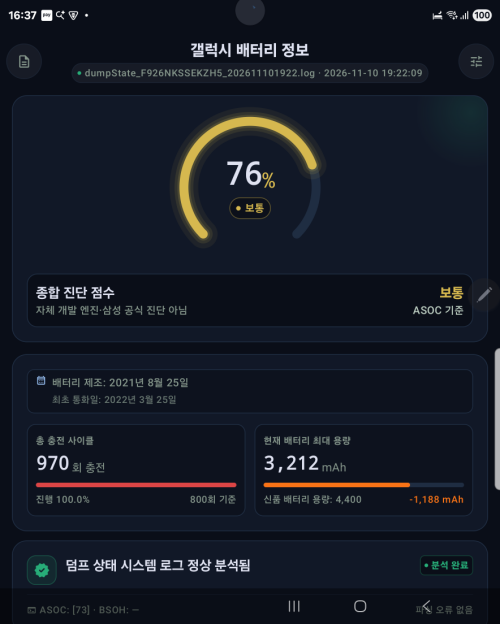
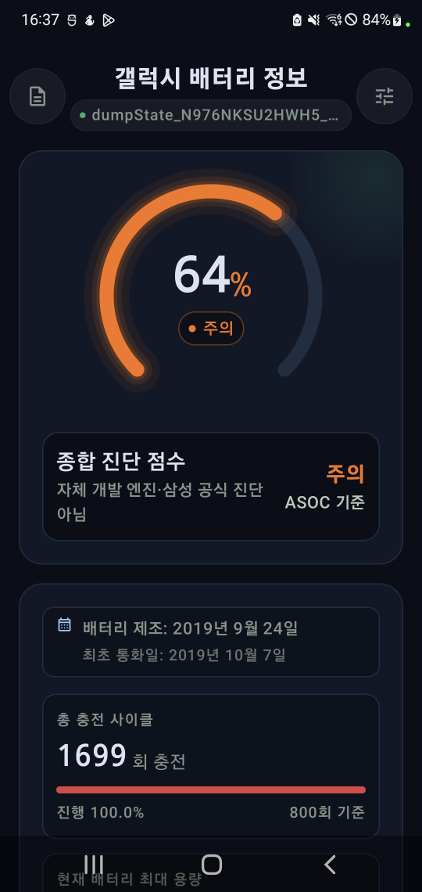

# 갤럭시 배터리 정보 (Galaxy Battery)

삼성 덤프스테이트 배터리 로그(`dumpState_*.log`)를 읽어 배터리 건강도(SOH),
충전 사이클과 용량을 보여주는 오프라인 진단 앱입니다.

## 스크린샷

<table>
  <tr>
    <td align="center"></td>
    <td align="center"></td>
  </tr>
  <tr>
    <td align="center"><b>폴드3 (Galaxy Z Fold3)</b></td>
    <td align="center"><b>노트10+ (Galaxy Note10+)</b></td>
  </tr>
</table>

## 지원 시리즈

- Galaxy S: S10, S20, S21, S22, S23, S25, S26
- Galaxy Z Fold: Fold 1, Fold 2, Fold 3, Fold 4, Fold 5, Fold 6, Fold 7, Fold 8
- Galaxy Z Flip: Flip 1, Flip 3, Flip 4, Flip 5, Flip 6, Flip 7, Flip 8
- Galaxy Note: Note10, Note10+, Note20

- 앱 이름: 갤럭시 배터리 정보
- 패키지: `com.alyaqdhan.galaxy_battery`
- 버전: 2.2 (versionCode 20200)
- 최소 요구: Android 8.0 (minSdk 26) / 대상 SDK 37

> [!IMPORTANT]
> 이 앱은 공식 Samsung 앱이 아닙니다.
> 배터리 건강도 판정과 환산 사이클은 앱 내부 계산 기준의 참고값입니다.
> 배터리 진단 결과는 기기에서 사용할 수 있는 로그 파일에 따라 달라지며, 삼성 공식 진단 결과가 아닙니다.
> 모든 데이터는 기기 안에서만 처리되고 외부로 전송되지 않습니다.

## 주요 기능

- **배터리 건강도 판정**: ASOC와 Battery Usage를 사용하는 앱 내부 등급입니다.
  원본 Battery Usage를 100으로 나눈 환산 사이클은 비공식 값이며 삼성 공식 진단식이 아닙니다.
- **충전 사이클**: 마모 단계(마모 없음 / 낮음 / 보통 / 높음), 800회 기준 진행률
- **용량 상태**: 실측 유효 용량(없으면 충전 카운터와 레벨로 추정), 설계 용량 대비 차이
- **분석 요약 카드**: 파싱 성공/실패/지원되지 않음 상태와 ASOC·BSOH 원시 값
- **진단 리포트 내보내기**: 공유 시트로 텍스트 리포트 전송
- **로그 찾아보기**: 폴더 안의 `dumpState_*.log` 목록, 다른 로그 파일 선택, 원본 배터리 라인 보기(검색 지원)
- **폴더 관리**: 폴더 변경, 접근 권한 제거, 저장 공간 삭제 후 폴더 다시 불러오기
- **로그 생성 가이드**: `*#9900#` 다이얼 → dumpstate/logcat 실행 → sdcard 복사 → 폴더 권한 부여
  (다이얼 코드는 앱에서 직접 편집 가능)
- **`*#9900#`가 "연결에 문제가 있거나 MMI 코드가 잘못되었습니다"로 뜰 때**:
  - 코드는 **끝의 `#`까지 포함한 `*#9900#` 전체**를 입력해야 합니다. (앱 기본값은 `*#9900`이며, 다이얼러에서 `#`을 직접 붙여야 합니다)
  - 반드시 **삼성 기본 전화 앱**에서 입력하세요. Google Phone 등 다른 다이얼러는 MMI 코드를 차단할 수 있습니다.
  - 일부 통신사·지역 펌웨어(CSC)에서는 해당 MMI 코드 자체가 비활성화되어 있을 수 있습니다. 이 경우 다른 SIM 제거 후 재시도, 안전 모드, 또는 PC에서 `adb shell dumpstate`로 로그를 수집해 sdcard로 복사하는 방법을 사용하세요.
  - 코드가 먹히지 않으면 앱 설정에서 다이얼 코드를 `*#9900#`로 직접 편집해 보세요.

- **"폴더를 잘못 선택했습니다" / `dumpState_*.log`를 찾지 못할 때**:
  - 앱은 선택한 폴더와 그 **바로 아래 하위 폴더 1단계**에서만 `dumpState_*.log`(대소문자 무관) 파일을 찾습니다. 더 깊은 경로에 있으면 상위 폴더를 다시 선택하세요.
  - 파일 이름이 `dumpState_`로 시작하고 `.log`로 끝나야 합니다. `dumpstate_log.txt`처럼 이름/확장자가 다르면 인식하지 않습니다.
  - **폴더**를 선택해야 합니다. 단일 파일 선택은 지원하지 않습니다. 로그가 있는 폴더(예: `/Device/log/`)를 선택하세요.
  - 파일이 보여도 파싱에 실패하면(배터리 정보가 없는 로그) 같은 오류가 뜰 수 있습니다. SysDump에서 **dumpstate/logcat**을 실행해 생성된 최신 `dumpState_*.log`를 선택하세요.
- **로그 캐시**: 마지막으로 분석한 결과를 저장해, 같은 로그는 즉시 표시하고 새 파일이 생기면 다시 분석.
  판정에 쓰는 원본 값(ASOC·BSOH·Battery Usage)을 함께 저장하므로 캐시에서도 같은 등급·점수가 나옵니다.
  저장 항목이 바뀌면 캐시 버전(`cache_schema_version`)이 올라가 이전 캐시는 자동으로 버려집니다.

## 배터리 날짜 표기

배터리 날짜는 **세 종류**이고 서로 완전히 다른 의미입니다. 기종에 따라 존재하는 필드가 다릅니다.

| 로그 필드 | 의미 | 교체 시 | Note 10+ | 폴드3 |
|---|---|---|---|---|
| `LLB MAN: YYYYMMDD` | **배터리 제조일** | 새 배터리의 생산일로 변경 | `20190924` | `20210825` |
| `LLB CAL: YYYYMMDD` | **배터리 최초 보정/사용일** | 공식 센터 교체+초기화 시 교체 당일 | `20190925` | (빈 값) |
| `battery FirstUseDate: [YYYYMMDD]` | **기기(메인보드) 최초 사용일** | 유지됨 | (없음) | `20230310` |

> [!IMPORTANT]
> **배터리 장착일은 화면에 표시하지 않습니다.** 로그에 장착일을 확정할 수 있는 값이 없기 때문입니다.
> - `LLB CAL`은 조건부로만 장착일을 의미하고(공식 센터 교체+초기화 시), 2021년 하반기 이후 기종은 비어 있습니다.
> - `battery FirstUseDate`는 기기(메인보드) 최초 사용일로 배터리 교체와 무관합니다.
>
> 대신 확실한 두 값만 보여줍니다: **`LLB MAN`(배터리 제조일)**, **`ril.actdate`(최초 통화일)**.

### `FirstUseDate`가 최초 통화일과 다른 이유

출고 당시(2022년 3월) 소프트웨어에는 해당 날짜를 영구 영역(EFS)에 기록하는 로직이
없었으나, 2023년 3월경 진행된 One UI 대규모 업데이트(또는 초기화) 시점에 해당
로깅 기능이 추가되면서 부팅 당일 날짜가 최초 기록일로 자동 저장되었기 때문입니다.

### `LLB CAL`이 없는 기종

`LLB CAL`은 2021년 하반기 이후 출시 기종에서 대부분 비어 있습니다.

| 계열 | 대상 모델 | 비고 |
|---|---|---|
| Z 폴더블 | 폴드3, 플립3, 폴드4, 플립4, 폴드5, 플립5, 폴드6, 플립6 이후 | 듀얼 배터리 구조 도입으로 최초 제외 |
| S 시리즈 | S22, S23, S24, S25, S26 전체 (기본·플러스·울트라·FE) | |
| A / M / 탭 | A33, A53, A34, A54, A35, A55 및 후속, 탭 S8·S9·S10 이후 | 2021년 하반기~2022년 이후 출시분 |

> [!NOTE]
> 폴드3 실기기 로그에서 `LLB CAL:` 값이 빈 것을 확인했습니다.
> 파서는 값의 유무만 보고 동작하므로 기종 목록에 의존하지 않습니다.

### 화면 표기

항상 두 줄로 표시합니다.

- 기본 줄: `배터리 제조: 2019년 9월 24일`
- 보조 줄: `최초 통화일: 2019년 10월 7일`
- 제조일이 없으면 `배터리 날짜 정보 없음`
- 이미 기본 줄에 쓰인 날짜는 보조 줄에서 중복 표시하지 않음

`LLB CAL`은 파싱해 `calibratedDateMs`로 보관하지만 화면에는 쓰지 않습니다.

### `ril.actdate` (최초 통화일)

`[ril.actdate]: [20220325]`는 **기기 최초 통화일**입니다. 배터리 블록이 아니라
SYSTEM PROPERTIES 영역에 있어 파서가 별도로 읽어 `activationDateMs`로 보관합니다.

| | Note 10+ | 폴드3 |
|---|---|---|
| `ril.actdate` | 2019-10-07 | 2022-03-25 |
| `LLB MAN` | 2019-09-24 | 2021-08-25 |

Note 10+는 제조(9/24) → 보정(9/25) → 개통(10/7) 순서로 자연스럽지만,
폴드3은 제조(2021-08) → 개통(2022-03)으로 약 7개월의 재고 기간이 있습니다.
이 값은 배터리 날짜가 아니므로 개월 수 계산에는 쓰지 않고 참고 정보로만 표시합니다.

> [!WARNING]
> 아래 경우 `LLB CAL`이 실제 교체일과 다를 수 있습니다.
>
> - 셀만 교체하고 BMS 회로를 재사용한 경우 → 이전 날짜 유지
> - 배터리 초기화가 불완전한 경우 → 이전 날짜 유지
> - One UI 5.1+로 업데이트된 구형 기종 → `LLB CAL`이 비어 값을 알 수 없음
>
> 이 한계 때문에 개월 수는 참고값으로만 제공합니다.
>
> 어느 필드가 쓰였는지 화면에 함께 표시해 사용자가 직접 판단할 수 있게 합니다.

## 건강도 판정 우선순위 및 점수 산정

건강도 입력값 H는 **BSOH 우선** 규칙 하나로 정합니다. `mSavedBatteryBsoh`가 유효한 값(1~100)이면 BSOH를 쓰고, 그렇지 않으면 `mSavedBatteryAsoc`가 유효할 때 ASOC를 씁니다.
환산 사이클 N = mSavedBatteryUsage ÷ 100 (소수점 버림).

> [!IMPORTANT]
> 이 규칙은 판정뿐 아니라 **표시와 측정 용량 추정에도 그대로 적용**됩니다. 즉 화면의 건강도 값·게이지·점수·추정 용량이 모두 같은 H를 공유합니다. (`BatteryInfo.healthPercent`와 `BatteryInfo.assessment`가 같은 규칙으로 계산됨)
> 과거에는 판정은 BSOH 우선, 표시는 ASOC 우선으로 갈라져 있어 같은 로그에서 화면값과 점수가 어긋날 수 있었습니다.

아래 조건을 위에서부터 확인해 처음 일치하는 결과를 사용합니다.

| 순서 | 조건 | 결과 |
| --- | --- | --- |
| 1 | H ≤ 55 및 N ≥ 1200 | 나쁨 (수명 종료) |
| 2 | N ≥ 1200 | 주의 |
| 3 | H ≤ 65 (N 30~1199) | 주의 |
| 4 | H 66~79, N 30~500 | 나쁨 (조기 열화) |
| 5 | H 66~79, N 501~1199 | 보통 |
| 6 | H 80~84, N 30~(T−1) | 나쁨 (조기 열화) |
| 7 | H 80~84, N T~1199 | 정상 |
| 8 | H 85~100, N 30~1199 | 정상 |
| 그 외 | 위 조건에 걸리지 않는 H(-2, 101) 또는 N 0~29 | 아래 표 참조 |

T는 H 80/81/82/83/84에서 각각 500/467/434/400/350이고, 그 외 H는 501을 씁니다.

### 판정 불가·오류 경로

| 상황 | 등급 | 화면 문구 |
| --- | --- | --- |
| 사이클을 읽지 못함(없음·음수) | 판정 불가(UNDETERMINED) | 데이터 오류 |
| 사이클 0~29 (진단 하한 미만) | 진단 불가 | 진단 불가(사이클 부족) |
| 건강도 입력 없음(-1, 0, 미존재) | 산정 불가 | 산정 불가 |
| 건강도 입력이 1~100 범위 밖(-2, 101) | 판정 불가(UNDETERMINED) | 데이터 오류 |

진단 하한은 `BatteryHealthClassifier.MIN_CYCLES_FOR_DIAGNOSIS`(=30) 상수로, 판정과 점수 공식 양쪽이 공유합니다.

### 종합 진단 점수 공식

모든 A와 C는 계산 후 0~1 범위로 제한(coerceIn)합니다.

| 등급 | 점수 구간 | 공식 | A | C |
| --- | --- | --- | --- | --- |
| 정상 | 85~100 | 85 + 15 × A^0.4 × C^0.6 | (H−80)/20 | (1199−N)/1199 |
| 보통 | 70~84 | 70 + 14 × A^0.4 × C^0.6 | (H−66)/13 | (1199−N)/698 |
| 주의 | 50~69 | 50 + 19 × A^0.4 × C^0.6 | (H−50)/15 | 1−(N−1200)/1200 |
| 나쁨(수명 종료) | 0~19 | 19 × A^0.4 × C^0.6 | H/55 | 1−(N−1200)/1800 |
| 나쁨(조기 열화) | 20~49 | 20 + 29 × (N−30)/(T−30) | 없음 | 없음 |

나쁨(조기 열화)의 T는 H 66~79이면 501, H 80~84이면 위 T 표의 값입니다.
최종 점수는 반올림(roundToInt)한 뒤 해당 등급의 점수 구간으로 한 번 더 제한합니다.


## 수집하는 값

`BatteryParser`가 로그에서 읽어오는 항목입니다.

> [!NOTE]
> 수집 가능한 항목은 기기 모델·펌웨어·로그 종류에 따라 달라질 수 있으며, 로그에 해당 값이 없으면 화면에 `—`로 표시되거나 항목이 나타나지 않을 수 있습니다.

| 항목 | 로그 형식 | 의미 |
| --- | --- | --- |
| ASOC | `mSavedBatteryAsoc` | 앱 내부 건강도 판정값 |
| BSOH | `mSavedBatteryBsoh` | 건강도 판정 입력값(있으면 우선 사용, 임계값은 ASOC 기준을 준용하며 아직 검증되지 않음) |
| 사이클 | `mSavedBatteryUsage` | 원시 값은 비공식 사이클 환산값 × 100 (예: `157000` → 1570회) |
| 배터리 날짜 | `LLB CAL` / `LLB MAN` | 배터리 제조·조립일 |
| 로그 시각 | `== dumpstate:`, `[YYYY-MM-DD HH:MM:SS]`, 파일명 | 로그 생성 시각(없으면 파일명에서) |
| 레벨 | `level:` | 현재 충전량(%) |
| 충전 카운터 | `charge counter:` / 인라인 `cc:` | µAh → mAh 변환 |
| 유효 용량 | `Maximum capacity:` | µAh → mAh 변환, 없으면 카운터와 레벨로 추정 |
| 설계 용량 | `Design capacity:` | µAh → mAh 변환 |

인라인 사이클 및 충전 카운터 형식은 배터리 서비스 로그의 `ACTION_BATTERY_CHANGED` 줄에서 읽습니다.
예: `... cycle_count:0, cc:3643752`

## 기술 스택

- Kotlin 2.4.21, Jetpack Compose (BOM 2026.09.00), Material3 1.5.0-rc01
- Android Gradle Plugin 9.5.1 (Kotlin 내장 컴파일러 사용)
- compileSdk/targetSdk 37, minSdk 26, Java 11 호환
- AndroidX: core-ktx, lifecycle-runtime/viewmodel, activity-compose
- 파일 접근은 Storage Access Framework(문서 트리 URI + 영구 권한)만 사용
- 단위 테스트: JUnit 4 / UI 테스트: Compose UI Test, Espresso

## 프로젝트 구조

```
app/src/main/java/com/alyaqdhan/galaxy_battery/
├── AppViewModel.kt          # 화면 상태와 폴더/스캔 흐름 전체 제어
├── GalaxyBatteryApp.kt      # 앱 전용 공유 AppViewModel 소유
├── MainActivity.kt          # 대시보드 호스트
├── SetupActivity.kt         # 폴더 권한 부여/변경, 다이얼 코드
├── LogRawActivity.kt        # 원본 배터리 라인 화면 호스트
├── BatteryParser.kt         # 로그 파싱 본문(Android 의존 없는 순수 로직)
├── parser/                  # 파서 조각: 기기별 설계 용량표·파일 이름·숫자 스캐너
├── BatteryCache.kt          # SharedPreferences 기반 결과 캐시(스키마 버전)
├── BatteryModels.kt         # BatteryInfo, DocEntry, ErrorDialog
├── BatteryHealth.kt         # 앱 내부 배터리 건강도 판정 로직(비공식)
├── BatteryReport.kt         # 공유용 진단 리포트 텍스트 생성
├── GaugeComponents.kt       # 게이지·메트릭 타일·텔레메트리 행
├── SetupComponents.kt       # 설정 화면 구성 요소
├── CommonComponents.kt      # 공통 UI 조각
├── LogComponents.kt         # 원본 로그 줄 색상 강조·검색 하이라이트 빌더
├── MatchedIcon.kt           # 텍스트 굵기에 맞춰 늘어나는 아이콘
├── ErrorDialogs.kt          # 오류 다이얼로그
├── Localization.kt          # 숫자·날짜·상대 시간 지역화
├── SystemColors.kt          # 기기 테마 색상 반영
├── data/BatteryRepository.kt # SAF/SharedPreferences 접근 단일 진입점
├── ui/main/MainScreen.kt    # 대시보드 + 로그 목록 시트
├── ui/setup/SetupScreen.kt  # 설정 화면
├── ui/rawlog/RawLogScreen.kt# 원본 로그 화면
├── ui/theme/                # Color/Type/Theme
└── viewmodel/               # 상태 묶음(FolderState, BatteryState 등)
```

## 빌드와 테스트

```bash
# 디버그 APK 빌드 (app/build/outputs/apk/debug/app-debug.apk)
./gradlew :app:assembleDebug

# 단위 테스트
./gradlew :app:testDebugUnitTest

# 기기/에뮬레이터 UI 테스트
./gradlew :app:connectedDebugAndroidTest
```

단위 테스트는 파서(`BatteryParserTest`), 판정(`BatteryHealthTest`),
캐시 왕복(`BatteryCacheTest`), 지역화(`LocalizationTest`),
스크롤바·테마(`ScrollbarTest`, `SystemColorsTest`)를 다룹니다.
`BatteryCacheTest`는 SharedPreferences를 흉내 내어 "파싱 직후 판정"과
"캐시 복원 후 판정"이 같은지 확인합니다. (BSOH 소실 회귀 방지)
UI 테스트는 `SetupScreenUiTest`가 설정 화면의 버튼과 앱 이름을 확인합니다.

## 지역화

- 한국어가 기본(`values/strings.xml`), 영어는 `values-en/strings.xml` — 지원 언어는 한국어와 영어뿐입니다

## 라이선스 및 면책

이 프로젝트는 [Alyaqdhans/MyBattery](https://github.com/Alyaqdhans/MyBattery) 저장소를 참고하여 개발되었습니다.

이 저장소는 [CC BY-NC-SA 4.0](https://creativecommons.org/licenses/by-nc-sa/4.0/) (Creative Commons Attribution-NonCommercial-ShareAlike 4.0 International) 라이선스를 따르며, 자세한 내용은 [LICENSE](LICENSE) 파일을 참고하세요.

- **저작자 표시 (BY)**: 원저작자 및 출처를 표시해야 합니다.
- **비상업적 이용 (NC)**: 본 소프트웨어의 전부 또는 일부를 상업적 목적으로 이용할 수 없습니다.
- **동일조건변경허락 (SA)**: 본 소프트웨어의 전부 또는 일부를 사용·수정·포함한 저작물(파생물 포함)을 배포·공개·제공하는 경우, 해당 소스 코드를 **동일한 라이선스(CC BY-NC-SA 4.0) 조건으로 공개**해야 합니다.

앱은 기기 로그를 읽기만 하며 원본 파일을 수정하지 않습니다.

> [!WARNING]
> 배터리 진단 결과는 참고용이며, 정확한 배터리 상태는 공식 서비스 센터에서 확인하세요.
