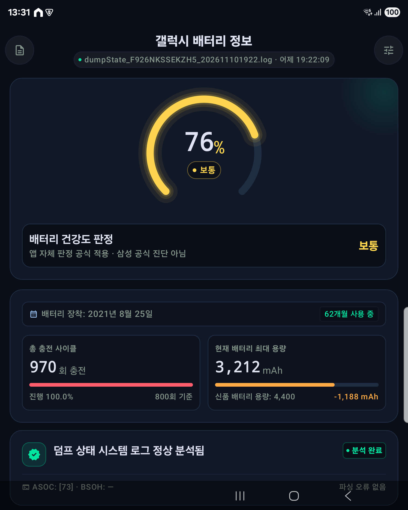
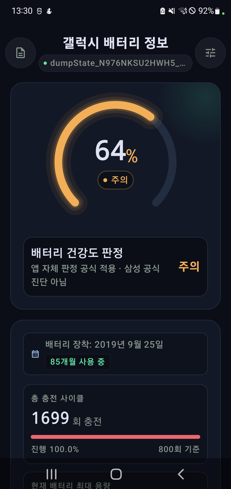

# 갤럭시 배터리 정보 (Galaxy Battery)

삼성 덤프스테이트 배터리 로그(`dumpState_*.log`)를 읽어 배터리 건강도(SOH),
충전 사이클과 용량을 보여주는 오프라인 진단 앱입니다.

## 스크린샷

<table>
  <tr>
    <td align="center"></td>
    <td align="center"></td>
  </tr>
  <tr>
    <td align="center"><b>폴드3 (Galaxy Z Fold3)</b></td>
    <td align="center"><b>노트10+ (Galaxy Note10+)</b></td>
  </tr>
</table>

## 지원 시리즈

- Galaxy S: S10, S20, S21, S22, S23, S25, S26
- Galaxy Z Fold: Fold 1, Fold 2, Fold 3, Fold 4, Fold 5, Fold 6, Fold 7, Fold 8
- Galaxy Z Flip: Flip 1, Flip 3, Flip 4, Flip 5, Flip 6, Flip 7, Flip 8
- Galaxy Note: Note10, Note10+, Note20

- 앱 이름: 갤럭시 배터리 정보
- 패키지: `com.alyaqdhan.galaxy_battery`
- 버전: 2.1.1 (versionCode 20110)
- 최소 요구: Android 8.0 (minSdk 26) / 대상 SDK 37

> [!IMPORTANT]
> 이 앱은 공식 Samsung 앱이 아닙니다. 
> 배터리 건강도 판정과 환산 사이클은 앱 내부 계산 기준의 참고값입니다.
> 배터리 진단 결과는 기기에서 사용할 수 있는 로그 파일에 따라 달라지며, 삼성 공식 진단 결과가 아닙니다.
> 모든 데이터는 기기 안에서만 처리되고 외부로 전송되지 않습니다.

## 주요 기능

- **배터리 건강도 판정**: ASOC와 Battery Usage를 함께 사용하는 앱 내부 판정 등급과
  원본값을 표시합니다. 환산 사이클은 비공식 값이며 삼성 공식 진단식이 아닙니다.
- **충전 사이클**: 마모 단계(마모 없음 / 낮음 / 보통 / 높음), 800회 기준 진행률
- **용량 상태**: 실측 유효 용량(없으면 충전 카운터와 레벨로 추정), 설계 용량 대비 차이
- **분석 요약 카드**: 파싱 성공/실패/지원되지 않음 상태와 ASOC·BSOH 원시 값
- **진단 리포트 내보내기**: 공유 시트로 텍스트 리포트 전송
- **로그 찾아보기**: 폴더 안의 `dumpState_*.log` 목록, 다른 로그 파일 선택, 원본 배터리 라인 보기(검색 지원)
- **폴더 관리**: 폴더 변경, 접근 권한 제거, 저장 공간 삭제 후 폴더 다시 불러오기
- **로그 생성 가이드**: `*#9900#` 다이얼 → dumpstate/logcat 실행 → sdcard 복사 → 폴더 권한 부여
  (다이얼 코드는 앱에서 직접 편집 가능)
- **로그 캐시**: 마지막으로 분석한 결과를 저장해, 같은 로그는 즉시 표시하고 새 파일이 생기면 다시 분석

> [!NOTE]


## 수집하는 값

`BatteryParser`가 로그에서 읽어오는 항목입니다.

> [!NOTE]
> 수집 가능한 항목은 기기 모델·펌웨어·로그 종류에 따라 달라질 수 있으며, 로그에 해당 값이 없으면 화면에 `—`로 표시되거나 항목이 나타나지 않을 수 있습니다.

| 항목 | 로그 형식 | 의미 |
| --- | --- | --- |
| ASOC | `mSavedBatteryAsoc` | 앱 내부 건강도 판정값 |
| BSOH | `mSavedBatteryBsoh` | 보조 표시값이며 건강도 판정에는 사용하지 않음 |
| 사이클 | `mSavedBatteryUsage` | 원시 값은 비공식 사이클 환산값 × 100 (예: `157000` → 1570회) |
| 배터리 날짜 | `LLB CAL` / `LLB MAN` | 배터리 제조·조립일 |
| 로그 시각 | `== dumpstate:`, `[YYYY-MM-DD HH:MM:SS]`, 파일명 | 로그 생성 시각(없으면 파일명에서) |
| 레벨 | `level:` | 현재 충전량(%) |
| 충전 카운터 | `charge counter:` / 인라인 `cc:` | µAh → mAh 변환 |
| 유효 용량 | `Maximum capacity:` | µAh → mAh 변환, 없으면 카운터와 레벨로 추정 |
| 설계 용량 | `Design capacity:` | µAh → mAh 변환 |

인라인 사이클 및 충전 카운터 형식은 배터리 서비스 로그의 `ACTION_BATTERY_CHANGED` 줄에서 읽습니다.
예: `... cycle_count:0, cc:3643752`

## 기술 스택

- Kotlin 2.4.21, Jetpack Compose (BOM 2026.09.00), Material3 1.5.0-rc01
- Android Gradle Plugin 9.5.1 (Kotlin 내장 컴파일러 사용)
- compileSdk/targetSdk 37, minSdk 26, Java 11 호환
- AndroidX: core-ktx, lifecycle-runtime/viewmodel, activity-compose
- 파일 접근은 Storage Access Framework(문서 트리 URI + 영구 권한)만 사용
- 단위 테스트: JUnit 4 / UI 테스트: Compose UI Test, Espresso

## 프로젝트 구조

```
app/src/main/java/com/alyaqdhan/galaxy_battery/
├── AppViewModel.kt          # 화면 상태와 폴더/스캔 흐름 전체 제어
├── GalaxyBatteryApp.kt      # 앱 전용 공유 AppViewModel 소유
├── MainActivity.kt          # 대시보드 호스트
├── SetupActivity.kt         # 폴더 권한 부여/변경, 다이얼 코드
├── LogRawActivity.kt        # 원본 배터리 라인 화면 호스트
├── BatteryParser.kt         # 로그 파싱(Android 의존 없는 순수 로직)
├── BatteryCache.kt          # SharedPreferences 기반 결과 캐시
├── BatteryModels.kt         # BatteryInfo, DocEntry, ErrorDialog
├── BatteryHealth.kt         # 앱 내부 배터리 건강도 판정 로직(비공식)
├── BatteryReport.kt         # 공유용 진단 리포트 텍스트 생성
├── GaugeComponents.kt       # 게이지·메트릭 타일·텔레메트리 행
├── SetupComponents.kt       # 설정 화면 구성 요소
├── CommonComponents.kt      # 공통 UI 조각
├── LogComponents.kt         # 원본 로그 줄 색상 강조·검색 하이라이트 빌더
├── MatchedIcon.kt           # 텍스트 굵기에 맞춰 늘어나는 아이콘
├── ErrorDialogs.kt          # 오류 다이얼로그
├── Localization.kt          # 숫자·날짜·상대 시간 지역화
├── SystemColors.kt          # 기기 테마 색상 반영
├── data/BatteryRepository.kt # SAF/SharedPreferences 접근 단일 진입점
├── ui/main/MainScreen.kt    # 대시보드 + 로그 목록 시트
├── ui/setup/SetupScreen.kt  # 설정 화면
├── ui/rawlog/RawLogScreen.kt# 원본 로그 화면
├── ui/theme/                # Color/Type/Theme
└── viewmodel/               # 상태 묶음(FolderState, BatteryState 등)
```

## 빌드와 테스트

```bash
# 디버그 APK 빌드 (app/build/outputs/apk/debug/app-debug.apk)
./gradlew :app:assembleDebug

# 단위 테스트
./gradlew :app:testDebugUnitTest

# 기기/에뮬레이터 UI 테스트
./gradlew :app:connectedDebugAndroidTest
```

단위 테스트는 파서(`BatteryParserTest`), 지역화(`LocalizationTest`),
스크롤바·테마(`ScrollbarTest`, `SystemColorsTest`)를 다룹니다.
UI 테스트는 `SetupScreenUiTest`가 설정 화면의 버튼과 앱 이름을 확인합니다.

## 지역화

- 한국어가 기본(`values/strings.xml`), 영어는 `values-en/strings.xml` — 지원 언어는 한국어와 영어뿐입니다

## 라이선스 및 면책

이 프로젝트는 [Alyaqdhans/MyBattery](https://github.com/Alyaqdhans/MyBattery) 저장소를 참고하여 개발되었습니다.

이 저장소의 코드는 프로젝트에 포함된 라이선스 조항에 따릅니다.
앱은 기기 로그를 읽기만 하며 원본 파일을 수정하지 않습니다.

> [!WARNING]
> 배터리 진단 결과는 참고용이며, 정확한 배터리 상태는 공식 서비스 센터에서 확인하세요.
